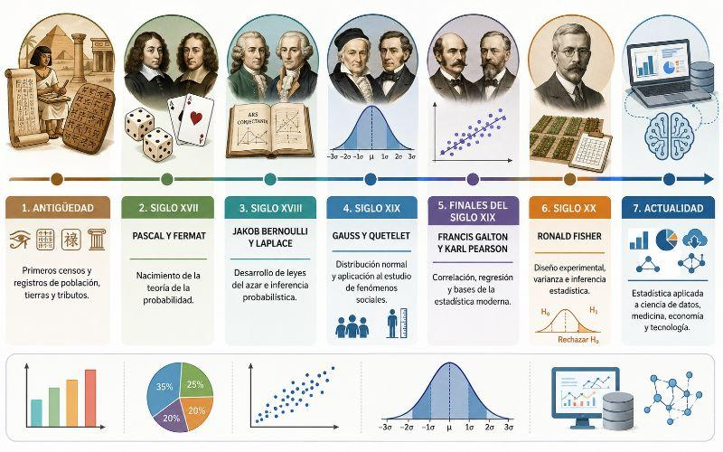
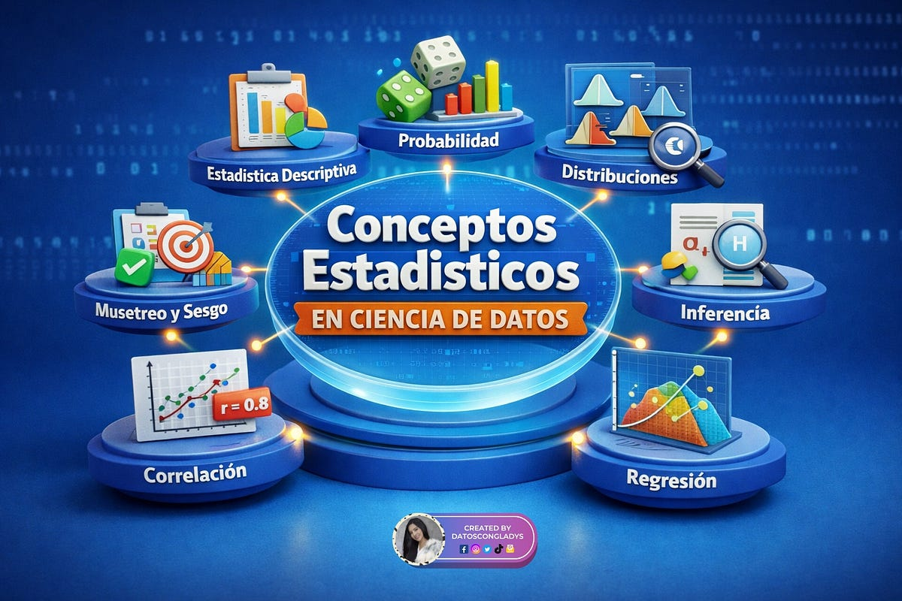
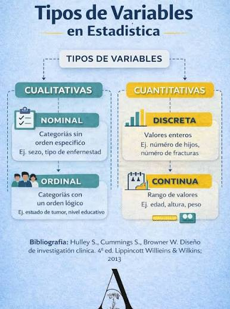

```{=html}
<div style="position:absolute; top:10px; right:10px;">

</div>
```

```{=html}
<style>
body{
  background-color:#bab056;
  font-size:130%;
  text-align:justify;
}
</style>
```

# .Presentación

Esta guía integra, en forma didáctica, los documentos **Historia de la Estadística**, **Introducción - tipos de datos** y **Variables, niveles de medición**, recopilados o elaborados por el profesor **Dagoberto Salgado Horta**. Se añaden explicaciones metodológicas y ejemplos originales reproducibles en **R**, identificados como ampliaciones pedagógicas. Su propósito es comprender cómo se transforman datos en información útil y cómo elegir el tratamiento estadístico de acuerdo con la naturaleza y escala de cada variable.

**Resultados de aprendizaje.** Al finalizar, el lector podrá explicar las principales etapas históricas de la estadística, distinguir estadística descriptiva e inferencial, identificar población y muestra, clasificar variables cualitativas y cuantitativas, reconocer las cuatro escalas de medición y ejecutar análisis iniciales con R.

# .Historia de la estadística

{fig-align="center"}

**De los registros al análisis**

La estadística no nació como una disciplina formal: sus antecedentes están en prácticas antiguas de conteo y registro destinadas a administrar poblaciones, bienes, cultivos y recursos. El material histórico presenta las siguientes referencias y etapas:

| Período o civilización | Aportes destacados en el material de clase |
|------------------------------------|------------------------------------|
| Prehistoria | Marcas, símbolos y representaciones para contar personas, animales y bienes. |
| Babilonia (aprox. 3000 a. C.) | Tablillas de arcilla con registros de producción y comercio. |
| Egipto antiguo | Registros poblacionales y económicos, así como censos. |
| China antigua | Recuentos agrícolas, comerciales y poblacionales. |
| Grecia y Roma | Censos para administración, tributación, organización social y fines militares. |
| Edad Media | Continuación irregular de registros de tierras y recursos. |
| Cultura inca | Sistemas de registro administrativo, incluidos los quipus. |
| Siglos XVI–XVII | Consolidación de registros demográficos y estudio de la mortalidad. |
| Siglos XVII–XVIII | Desarrollo del cálculo de probabilidades. |
| Siglos XIX–XX | Teoría de errores, mínimos cuadrados, ampliación a ciencias sociales y métodos modernos. |
| Época contemporánea | Informática, visualización, grandes bases de datos e inferencia computacional. |

::: callout-note
El documento *Historia de la Estadística* ofrece una secuencia divulgativa de antecedentes históricos. Algunas fechas y afirmaciones puntuales son aproximadas o están presentadas sin respaldo primario; conviene verificarlas con historiografía especializada antes de usarlas como hechos históricos exactos.
:::

**Hitos del análisis estadístico**

En el siglo XVII, **John Graunt** utilizó registros de mortalidad para estudiar patrones demográficos. Los materiales también mencionan a **Gaspar Neumann** y **Edmond Halley** por sus contribuciones vinculadas con registros y tablas de mortalidad. La probabilidad fue desarrollándose mediante aportes de matemáticos como Bernoulli y Laplace; posteriormente se consolidaron métodos para estudiar errores de medición y ajustar modelos con mínimos cuadrados.

El contenido proporcionado sintetiza la evolución en tres grandes fases: **censos**, **descripción de conjuntos y aritmética política** y **estadística ligada al cálculo de probabilidades**. Con la informática, la estadística amplió su capacidad de análisis, visualización y procesamiento de datos.

**Interpretación actual (ampliación):** los registros son una fuente de observaciones; la estadística permite analizar su variabilidad, estimar cantidades desconocidas, cuantificar incertidumbre y orientar decisiones.

**¿Qué es la estadística?**

La **estadística** es la disciplina que estudia métodos para recopilar, organizar, describir, analizar e interpretar datos, a fin de sustentar conclusiones y decisiones bajo incertidumbre. Esta definición desarrolla la presentada en *Introducción - tipos de datos* (p. 2).

**Estadística descriptiva e inferencial**

| Rama | Propósito | Ejemplo | Técnicas habituales |
|------------------|------------------|------------------|------------------|
| **Descriptiva** | Resumir y presentar los datos observados. | Calcular la edad promedio de 80 encuestados. | Tablas, porcentajes, gráficos, media, mediana, dispersión. |
| **Inferencial** | Obtener conclusiones sobre una población a partir de una muestra, cuantificando la incertidumbre. | Estimar la proporción de estudiantes satisfechos a partir de una muestra aleatoria. | Intervalos de confianza, contrastes, modelos estadísticos. |

La **predicción** es otra aplicación de modelos estadísticos; no debe confundirse con la inferencia acerca de parámetros poblacionales. Una proyección requiere supuestos y validación.

# .Conceptos

{fig-align="center"}

| Concepto | Definición | Ejemplo |
|------------------------|------------------------|------------------------|
| **Población** | Conjunto total de unidades sobre las que se desea investigar. | Todos los estudiantes de una universidad durante un semestre. |
| **Muestra** | Subconjunto de unidades seleccionado de la población. | 120 estudiantes encuestados. |
| **Unidad de análisis** | Elemento sobre el que se registra información. | Un estudiante. |
| **Dato** | Valor observado o registrado de una variable en una unidad. | Edad = 23 años. |
| **Variable** | Característica que puede tomar diferentes valores entre unidades u observaciones. | Edad, programa académico, satisfacción. |
| **Parámetro** | Resumen numérico de una población. | Media de edad de toda la universidad, $\mu$. |
| **Estadístico** | Resumen calculado a partir de una muestra. | Media muestral, $\bar{x}$. |
| **Censo** | Observación de todas las unidades de la población definida. | Encuesta a todos los docentes de una facultad. |
| **Muestreo** | Procedimiento para seleccionar unidades de una población. | Selección aleatoria simple. |

En la práctica se emplean encuestas, entrevistas, cuestionarios, observación y registros administrativos, entre otras fuentes, como señala *Introducción - tipos de datos* (p. 8). **Una muestra no garantiza representatividad por sí sola**: esta depende del diseño de selección, la cobertura y las posibles pérdidas o sesgos.

# .Variables estadísticas

{fig-align="center"}

**Concepto y naturaleza**

Una **variable** es una característica que puede diferir entre las unidades de estudio o a lo largo del tiempo. Su clasificación depende de **qué representa realmente**, no simplemente de que esté almacenada como texto o número.

**Variables cualitativas o categóricas**

Describen categorías o atributos. Se resumen mediante frecuencias, porcentajes y gráficos de barras. Un código numérico puede identificar una categoría sin representar una cantidad: por ejemplo, `1 = urbano` y `2 = rural` sigue siendo una variable **cualitativa nominal**.

- **Nominales:** las categorías no poseen un orden intrínseco, como el medio de transporte o el municipio.
- **Ordinales:** las categorías tienen un orden significativo, como satisfacción *baja, media, alta*; las distancias entre categorías no son necesariamente iguales.

**Variables cuantitativas o numéricas**

Expresan cantidades que admiten operaciones numéricas con significado.

- **Discretas:** generalmente son resultados de conteos, por ejemplo, número de hijos o número de permisos registrados.
- **Continuas:** se asocian a magnitudes medibles en una escala continua, como estatura, duración, masa o distancia, incluso si el instrumento registra pocos decimales.

::: callout-important
**No todo número indica una variable cuantitativa.** La cédula, el código postal y los números de camisetas identifican categorías: no tiene sentido calcular su promedio. A la inversa, registrar una estatura con un decimal no la convierte en variable discreta.
:::

**Clasificación por naturaleza y ejemplos**

| Variable | Naturaleza | Subtipo | Justificación |
|------------------|------------------|------------------|------------------|
| Ciudad de residencia | Cualitativa | Nominal | Nombres sin jerarquía inherente. |
| Nivel de satisfacción (bajo, medio, alto) | Cualitativa | Ordinal | Categorías ordenables. |
| Número de estudiantes | Cuantitativa | Discreta | Cuenta unidades completas. |
| Número de visitas al mes | Cuantitativa | Discreta | Conteo de eventos. |
| Estatura en metros | Cuantitativa | Continua | Longitud medida. |
| Tiempo de desplazamiento | Cuantitativa | Continua | Duración medida. |
| Identificador de registro (`1001`, `1002`) | Cualitativa | Nominal | Números usados como etiquetas. |

# .Escalas o niveles de medición

Las escalas de medición establecen cuáles comparaciones y operaciones resultan **interpretables**. El material *Variables, niveles de medición* identifica cuatro niveles: nominal, ordinal, intervalo y razón (pp. 11–17).

| Escala | Propiedad esencial | Ejemplo | Operaciones pertinentes |
|------------------|------------------|------------------|------------------|
| **Nominal** | Identidad y diferencia entre categorías, sin orden. | Tipo de vehículo. | Conteos, proporciones, moda. |
| **Ordinal** | Categorías con orden, pero distancias no necesariamente equivalentes. | Nivel de satisfacción. | Conteos, mediana/cuantiles de orden, comparaciones de rangos. |
| **Intervalo** | Intervalos iguales, pero cero convencional. | Temperatura en °C. | Diferencias, media, desviación estándar; no proporciones como “el doble de caliente”. |
| **Razón** | Intervalos iguales y cero absoluto significativo. | Duración, distancia, masa. | Diferencias, razones, media y otras operaciones aritméticas. |

**Interpretaciones y precauciones**

**Nominal:** las categorías pueden ordenarse visualmente por frecuencia, pero ese orden no cambia su escala. Por ejemplo, el municipio más frecuente no es “mayor” que los demás.

**Ordinal:** conocer que una satisfacción es *alta* frente a *media* no permite asegurar que la diferencia sea la misma que entre *media* y *baja*. Las escalas tipo Likert de un solo ítem suelen tratarse como ordinales.

**Intervalo:** en grados Celsius, 20 °C y 10 °C difieren en 10 grados, pero 20 °C no representa el doble de temperatura termodinámica que 10 °C. El cero en °C no expresa ausencia de temperatura.

**Razón:** una duración de 20 minutos sí es el doble de una de 10 minutos; un valor cero significa ausencia de duración en la magnitud descrita.

**Puntos especiales:** una fecha del calendario es típicamente de intervalo cuando se analizan diferencias temporales; la duración entre dos fechas es de razón. Las calificaciones y puntuaciones requieren revisar cómo se construyó su escala antes de asignarles nivel.

**Matriz integral: naturaleza y escala**

| Variable | Naturaleza | Escala |
|------------------------|------------------------|------------------------|
| Tipo de transporte | Cualitativa nominal | Nominal |
| Grado de satisfacción | Cualitativa ordinal | Ordinal |
| Temperatura ambiente (°C) | Cuantitativa continua | Intervalo |
| Distancia recorrida (km) | Cuantitativa continua | Razón |
| Número de eventos | Cuantitativa discreta | Razón |
| Documento de identidad | Cualitativa nominal | Nominal |
| Año de nacimiento (año calendario) | Cuantitativa discreta en registro | Intervalo |

# .Aplicación introductoria en R

R permite almacenar variables, transformarlas, resumirlas y representarlas. Los siguientes ejemplos son **datos ficticios para aprendizaje** y utilizan únicamente funciones incluidas con R para facilitar su ejecución.

**Crear una base de datos**

```{r}
set.seed(2026)
n <- 80
estudio <- data.frame(
  id = sprintf("P%03d", seq_len(n)),
  transporte = sample(c("Bus", "Moto", "Carro", "A pie"), n, replace = TRUE),
  satisfaccion = factor(
    sample(c("Baja", "Media", "Alta"), n, replace = TRUE),
    levels = c("Baja", "Media", "Alta"), ordered = TRUE
  ),
  numero_permisos = rpois(n, lambda = 2),
  tiempo_min = round(rlnorm(n, meanlog = log(35), sdlog = .35), 1),
  temperatura_c = round(rnorm(n, mean = 24, sd = 2), 1)
)
head(estudio)
```

**Revisar clases de variables**

```{r}
str(estudio)
sapply(estudio, class)
```

En R, `character` almacena texto; `factor` representa categorías; `ordered factor` representa categorías con orden; `integer` y `numeric` representan números, pero **la clase de almacenamiento de R no determina por sí sola la escala estadística**.

**Frecuencias y porcentajes: nominal**

```{r}
frecuencias <- table(estudio$transporte)
frecuencias
round(prop.table(frecuencias) * 100, 1)
barplot(frecuencias, col = "steelblue", las = 2,
        main = "Frecuencia por medio de transporte",
        ylab = "Número de observaciones")
```

**Resumir una variable ordinal**

```{r}
table(estudio$satisfaccion)
barplot(table(estudio$satisfaccion), col = "darkseagreen3",
        main = "Distribución del nivel de satisfacción",
        xlab = "Categoría ordenada", ylab = "Frecuencia")
```

**Resumir variables cuantitativas**

```{r}
summary(estudio$numero_permisos)
mean(estudio$tiempo_min)
median(estudio$tiempo_min)
sd(estudio$tiempo_min)
quantile(estudio$tiempo_min, probs = c(.25, .5, .75))
```

**Gráficos para conteos y mediciones**

```{r}
par(mfrow = c(1, 2))
barplot(table(estudio$numero_permisos), col = "slateblue3",
        main = "Número de permisos", xlab = "Permisos", ylab = "Casos")
hist(estudio$tiempo_min, col = "skyblue", border = "white",
     main = "Tiempo de desplazamiento", xlab = "Minutos")
par(mfrow = c(1, 1))
```

**Lectura:** el gráfico de barras muestra frecuencias de valores de conteo; el histograma agrupa una variable continua en intervalos. En ambos casos son descripciones de esta muestra ficticia.

**Ejemplo básico de inferencia: proporción**

Supongamos que el indicador de interés es utilizar bus. Un intervalo de confianza para una proporción resume la precisión de una estimación **bajo los supuestos pertinentes del muestreo y del modelo**. Como los datos aquí fueron simulados con fines docentes, el resultado no describe ninguna población real.

```{r}
exitos <- sum(estudio$transporte == "Bus")
prop.test(x = exitos, n = nrow(estudio), correct = FALSE)
```

**Guía para decidir qué análisis realizar**

| Si la variable es... | Resúmenes recomendados | Gráficos iniciales |
|------------------------|------------------------|------------------------|
| Nominal | Frecuencias, porcentajes y moda. | Barras. |
| Ordinal | Frecuencias acumuladas, mediana categórica, proporciones. | Barras ordenadas. |
| Cuantitativa discreta | Media, mediana, dispersión y frecuencias. | Barras o histogramas según cantidad de valores. |
| Cuantitativa continua | Media, mediana, cuantiles, desviación estándar. | Histograma, densidad, diagrama de caja. |

**Nota:** la elección definitiva de una prueba estadística no depende únicamente del nivel de medición; también importan el diseño de muestreo, independencia de las observaciones, tamaño de muestra, distribución y pregunta científica.

# .Actividades de aprendizaje

**Actividad 1: clasifique las variables**

Para cada situación, indique **naturaleza, subtipo y escala**, y justifique brevemente su respuesta:

1.  Ciudad donde reside una persona.
2.  Número de libros leídos en un mes.
3.  Nivel de riesgo: bajo, medio, alto.
4.  Temperatura registrada en grados Celsius.
5.  Litros consumidos en un trayecto.
6.  Código numérico asignado a un estudiante.
7.  Tiempo para responder un formulario, en segundos.
8.  Año calendario de ingreso a una institución.

**Actividad 2: interpretación en R**

A partir de `estudio`, calcule el porcentaje de personas ficticias que utilizan moto, la mediana del tiempo de desplazamiento y el número máximo de permisos. Describa por qué no tendría sentido calcular una media de la variable `transporte`.

```{r}
# Solución orientativa
round(mean(estudio$transporte == "Moto") * 100, 1)
median(estudio$tiempo_min)
max(estudio$numero_permisos)
```

**Respuestas orientativas de la actividad 1**

| Ítem | Naturaleza y subtipo                      | Escala    |
|------|-------------------------------------------|-----------|
| 1    | Cualitativa nominal                       | Nominal   |
| 2    | Cuantitativa discreta                     | Razón     |
| 3    | Cualitativa ordinal                       | Ordinal   |
| 4    | Cuantitativa continua                     | Intervalo |
| 5    | Cuantitativa continua                     | Razón     |
| 6    | Cualitativa nominal                       | Nominal   |
| 7    | Cuantitativa continua                     | Razón     |
| 8    | Cuantitativa discreta como año registrado | Intervalo |

# .Conclusiones

La historia de la estadística refleja una transición desde el conteo administrativo hacia el análisis de variabilidad e incertidumbre. La distinción entre estadística descriptiva e inferencial determina el alcance de las conclusiones. Antes de calcular resúmenes o construir modelos, es indispensable reconocer la **unidad de análisis**, la **naturaleza de cada variable** y su **escala de medición**. R y Quarto permiten integrar código, resultados y argumentación en un informe reproducible.

**Fuentes y alcance de esta guía**

**Material suministrado por el usuario:**

1.  Salgado Horta, D. (comp.). *Historia de la Estadística*. Presentación, 40 páginas. Base para antecedentes, períodos e hitos históricos.
2.  Salgado Horta, D. *Estadística: Introducción - tipos de datos*. Material de clase, período 2026-1, 14 páginas. Base para definición, ramas, población, muestra e instrumentos.
3.  Salgado Horta, D. *Estadística: Variables, niveles de medición*. Material de clase, período 2026-1, 20 páginas. Base para clasificación de variables y niveles nominal, ordinal, intervalo y razón.

**Ampliación didáctica de esta guía:** precisiones sobre representatividad, parámetros y estadísticos, distinción entre códigos y cantidades, fechas y duración, interpretación de escalas y ejemplos originales en R. Se distingue de lo expresado literalmente en las presentaciones. Los datos generados son simulados y no representan observaciones reales.

**Cómo generar el documento desde RStudio**

Guarde este archivo con extensión `.qmd`. Abra el archivo en RStudio con Quarto instalado y seleccione **Render** para generar el HTML; también puede ejecutar en la terminal `quarto render Guia_Estadistica_Fundamentos_R_Quarto.qmd --to html`. No se requieren paquetes de R adicionales para los ejemplos incluidos.
